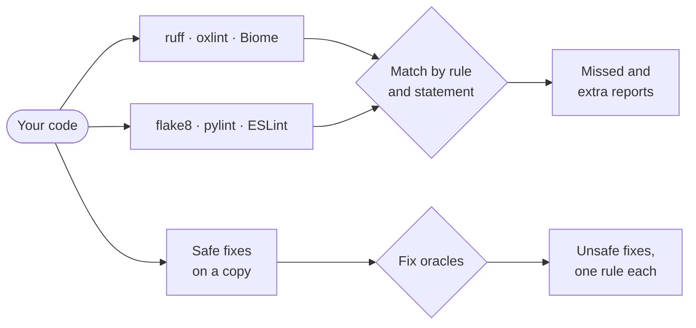

<h1 align="center">LintTwin</h1>

<p align="center"><b>Do Rust-rewritten linters keep their promises?</b></p>

<p align="center">
LintTwin tests <a href="https://github.com/astral-sh/ruff">ruff</a>, <a href="https://oxc.rs">oxlint</a> and
<a href="https://biomejs.dev">Biome</a> against the tools they replace — flake8, pylint and ESLint — on real code,
and checks that their "safe" autofixes are actually safe.
</p>

---

Rust rewrites of developer tools are fast, popular, and increasingly run unattended: in pre-commit hooks, in CI, and
inside AI coding agents that apply `--fix` without review. They make three promises, and LintTwin turns each one into an
automatic test:

| Promise | How LintTwin checks it |
|---|---|
| **Same rules** — a rule behaves like the original it re-implements | Uses the rewrite's own declared mapping (ruff's flake8/pylint codes, oxlint's ESLint rule names, Biome's `migrate eslint` table) to run each rule in both tools on the same files, and matches the diagnostics statement by statement. |
| **Safe fixes** — "safe" autofixes preserve your code | Applies every safe fix to a copy and checks that the code still parses, keeps its comments and names, and that no statement becomes dead or switches branch. Each failure is attributed to a single rule. |
| **Faithful migration** — migrating a config keeps its meaning | Runs the migrated configuration next to the original one and compares what they report. |

## What it found

We ran LintTwin on the 300 most-downloaded PyPI packages and the 100 most-downloaded npm packages, and triaged its
output with LLM agents in two passes ([how](triage/)). The first pass found **17 bugs** that we could not find
documented or already tracked. Each has a minimal reproducer; `linttwin findings` re-runs them all, and all 17 reproduce
on the study's releases (ruff 0.17.1, released since, ships the fix for RF-1). Maintainers have confirmed 14 and fixed 12
so far.

| | Tool | Rule | What goes wrong | Issue |
|---|---|---|---|---|
| OX‑1 | oxlint | `no-var` | Safe fix turns a redeclared `var` into two `const` declarations — **the code no longer parses** | [oxc#27694](https://github.com/oxc-project/oxc/issues/27694) · fixed |
| OX‑2 | oxlint | `unicorn/catch-error-name` | Safe fix renames `e` onto an existing `error` binding — **SyntaxError**, or silently captures an outer `error` | [oxc#27700](https://github.com/oxc-project/oxc/issues/27700) · fixed |
| OX‑3 | oxlint | `sort-keys` | Autofix moves the object's trailing comma into a line comment | [oxc#27704](https://github.com/oxc-project/oxc/issues/27704) |
| OX‑4 | oxlint | `no-setter-return` | Misses returning setters in `Object.defineProperty` descriptors | [oxc#27710](https://github.com/oxc-project/oxc/issues/27710) · fixed |
| OX‑5 | oxlint | `no-div-regex` | Misses `/=+$/`: a leading `=` with a quantifier | [oxc#27710](https://github.com/oxc-project/oxc/issues/27710) · fixed |
| OX‑6 | oxlint | `no-self-compare` | Reports `"Ā" !== "Ā"` (equal values, different source text) | |
| OX‑7 | oxlint | `no-magic-numbers` | Lifts literals under any unary operator, so `void 0`, `~5`, `!0` go unreported | [oxc#27710](https://github.com/oxc-project/oxc/issues/27710) · fixed |
| OX‑8 | oxlint | `id-length` | Misses destructuring assignment targets | [oxc#27710](https://github.com/oxc-project/oxc/issues/27710) · fixed |
| OX‑9 | oxlint | `no-shadow` | Misses a named function expression shadowing the variable it initialises | |
| OX‑10 | oxlint | `unicorn/consistent-function-scoping` | Reports functions that refer to themselves through their own binding | [oxc#27710](https://github.com/oxc-project/oxc/issues/27710) · fixed |
| RF‑1 | ruff | `RET505`–`RET508`, `PLW0120` | Dedent computed from the wrong comment: the fix fails with a syntax error, or **moves code into the `if` block** | [ruff#29381](https://github.com/astral-sh/ruff/issues/29381) · fixed |
| RF‑2 | ruff | `PLR5501` | Safe fix deletes the comment on an `else:` line | [ruff#29395](https://github.com/astral-sh/ruff/issues/29395) · fixed |
| RF‑3 | ruff | `PLW0120` | Safe fix deletes the comment on a loop's `else:` line | [ruff#29395](https://github.com/astral-sh/ruff/issues/29395) · fixed |
| RF‑4 | ruff | `UP035` | Safe fix deletes the comments inside a multi-line import (here a `noqa`) | [ruff#29400](https://github.com/astral-sh/ruff/issues/29400) · fixed |
| BI‑1 | Biome | `one-var` | `biome migrate eslint` maps it to a rule that **enforces the opposite** | [biome#12373](https://github.com/biomejs/biome/issues/12373) · confirmed |
| BI‑2 | Biome | `eqeqeq` | `biome migrate eslint` silently stops reporting `x == null` | [biome#12374](https://github.com/biomejs/biome/issues/12374) · fixed |
| BI‑3 | Biome | `no-setter-return` | Misses returning setters in property descriptors (as OX-4) | [biome#12375](https://github.com/biomejs/biome/issues/12375) · confirmed |

Biome declined one further report as intended behaviour: `noReturnAssign` flags `return (m = …) && …`, which
ESLint's default allows ([discussion #12377](https://github.com/biomejs/biome/discussions/12377)).

**Second pass.** The first pass covered the largest groups of disagreements and every rule with failing fixes. The
second covered every other disagreeing rule: three LLM agents classified 257 rules, and one verifier agent per rewrite
tried to refute each of the 55 bug candidates. Bugs held up in 47 rules, and re-running the reproducers before filing
removed one more. We have reported 30 of them, ruff 10 (one more safe-fix bug, `UP034`, among them) and oxlint 20, in
[ruff#29422](https://github.com/astral-sh/ruff/issues/29422) and [oxc#27746](https://github.com/oxc-project/oxc/issues/27746);
maintainers have confirmed 29 and fixed 15 so far. The prompts, inputs and verdicts are in [triage/](triage/).

## Quick start

Requires Python ≥ 3.12 and Node.js ≥ 20. Install with [uv](https://docs.astral.sh/uv/) (or `pipx install git+…`):

```console
$ uv tool install git+https://github.com/sariddangerpowers/linttwin
$ linttwin setup                  # installs the six linters into ~/.linttwin
$ linttwin check path/to/project  # compares each rewrite with its original, tests its safe fixes
$ linttwin findings               # do the 17 bugs still reproduce on the installed releases?
```

`linttwin setup --pinned` installs the exact versions used in our study (ruff 0.17.0, oxlint 1.88.0, Biome 2.5.15,
ESLint 10.12.0, flake8 7.4.1, pylint 4.1.3).

```console
$ linttwin check ~/src/debug ~/src/semver ~/src/pyflakes ~/src/flake8-simplify
ruff    494 diagnostics agree with the original, 8 disagree across 5 rules; 1 file fails a safe-fix check
oxlint  1628 diagnostics agree with the original, 88 disagree across 8 rules; 0 files fail a safe-fix check
biome   311 diagnostics agree with the original, 290 disagree across 13 rules; 0 files fail a safe-fix check

report: linttwin-report/report.md
```

The report lists every disagreeing rule with examples and every failing fix with its diff; the raw records are in
`divergences.jsonl.gz` and `fixes.jsonl.gz`.

### With Docker

The image contains LintTwin and the linters at the study's versions; your code is mounted read-only.

```console
$ docker build -t linttwin https://github.com/sariddangerpowers/linttwin.git
$ docker run --rm linttwin findings
$ docker run --rm -v "$PWD:/src:ro" -v "$PWD/linttwin-report:/out" linttwin check /src --out /out
```

## How it works



- **Rule pairs come from the rewrites themselves**, so nobody writes expected results by hand: the original tool's
  behaviour is the expected answer.
- **Matching is robust to anchoring:** two reports of the same rule in the same statement count as agreement even if
  they point at different columns or lines.
- **Fix oracles are cheap and generic:** syntax and comments via the language's own tokenizer; undefined names via
  pyflakes or ESLint's `no-undef`; two structural invariants (no reachable statement may become dead; no statement may
  switch branch) that catch fixes which dedent by the wrong amount.
- **Crashes are isolated:** a file that crashes a tool is retried alone and reported, without losing the rest.

## Reproducing the study

```console
$ linttwin setup --pinned
$ linttwin corpus --dir corpus                      # top-300 PyPI sdists + top-100 npm packages
$ linttwin check corpus/pypi/* --tool ruff --pylint # 45,901 Python files
$ linttwin check corpus/npm/* --tool oxlint         # 710 JavaScript files
$ linttwin check corpus/npm/* --tool biome
```

Not every divergence is a bug: the report also surfaces documented differences, version lag behind newer ESLint or
unicorn releases, and bugs in the original tools. The 17 findings above are the ones that survived that triage, each
reduced to a reproducer and checked against the original tool's behaviour. One negative result is worth stating: across
the 38,618 real files that ruff's safe fixes changed, we found no behaviour change; every file the structural oracle
flagged turned out, on review, to be a correct fix. RF-1 needs an unusual comment layout: real code (sympy) triggers only
its syntax-error variant, which ruff detects and reverts; its behaviour change comes from a constructed input.

## Tests

```console
$ uv run --extra test pytest    # the fix oracle and the findings registry; no linters needed
```

## License

MIT
